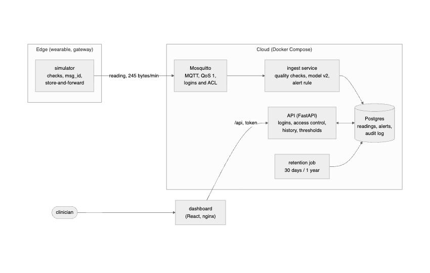

# Smart Vitals: Intelligent Patient Monitoring System

> A prototype that streams simulated patient vital signs, classifies each reading as Normal, Warning or Critical, alerts the assigned clinician, and shows trends on a clinician dashboard.

**Student:** Md Msud Rana · **Module:** CMS22301 Intelligent Systems and Emerging Technologies · Ravensbourne University London

## What it does

Two or three sentences for MedLink: who uses it, and what happens when a reading is Critical.

## Architecture



Where readings come from, where the model runs (edge, cloud or both), what crosses each arrow, and which parts run as containers. Key decisions: [`docs/adr/`](docs/adr/).

## How the requirements are met

See [`docs/requirements-checklist.md`](docs/requirements-checklist.md): each requirement, where it is implemented, and the test that proves it.

## Data

Simulated or open, and how the labels were made: [`data/DATA_CARD.md`](data/DATA_CARD.md). No real patient data is used.

## Model and results

| Measure             | Baseline | My model | My target |
| ------------------- | -------- | -------- | --------- |
| Recall for Critical |          |          |           |
| F1 (macro)          |          |          |           |

Details and the confusion matrix: [`docs/results/`](docs/results/).

## How to run it

```bash
pip install -r requirements.txt
pytest
# add: how to start the simulator, the API and the dashboard (e.g. docker compose up)
```

## Assumptions and limitations

See [`docs/assumptions.md`](docs/assumptions.md). What the prototype cannot do, and who it could fail.

## Use of AI tools

Where and how you used AI assistants, following the university's regulations.

## References

Harvard style: [`docs/report/references.md`](docs/report/references.md).
