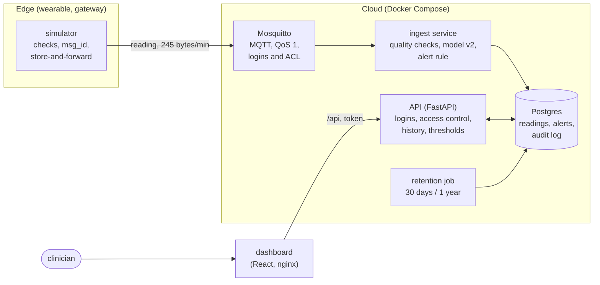

# Smart Vitals: Intelligent Patient Monitoring System

> A prototype that streams simulated patient vital signs, classifies each reading as Normal, Warning or Critical, alerts the assigned clinician, and shows trends on a clinician dashboard.

**Student:** Md Msud Rana · **Module:** CMS22301 Intelligent Systems and Emerging Technologies · Ravensbourne University London

**Prototype with simulated data only. Not a medical device.**

## What it does

Wearables send each MedLink patient's vital signs once a minute. Every reading is checked for sensor faults, classified by a machine learning model with a NEWS2-inspired rule as a safety net, and stored. When a patient becomes Critical, their assigned clinician is alerted at once with the patient ID, the vitals and the time, and reminded until they acknowledge it. Clinicians log in to a dashboard to see only their own patients, their trends and alerts, and to set alert limits for an individual patient.

## Architecture



As an image: [`docs/architecture.png`](docs/architecture.png) ([SVG](docs/architecture.svg)). The edge checks readings and keeps them while offline; the cloud runs the model, stores the history and raises alerts (ADR 3). Each part is its own container (ADR 8). Key decisions: [`docs/adr/`](docs/adr/). Edge versus cloud, measured: [`docs/approaches.md`](docs/approaches.md).

## How the requirements are met

See [`docs/requirements-checklist.md`](docs/requirements-checklist.md): each requirement, where it is implemented, and the test that proves it. Test cases and evidence: [`docs/test-plan.md`](docs/test-plan.md).

## Data

Simulated by our own code (80 patients × 3 days for training; 30 patients for the demo), with deterioration episodes and built-in sensor and network faults. Labels come from a NEWS2-inspired rule applied to the true vitals: [`data/DATA_CARD.md`](data/DATA_CARD.md). No real patient data is used.

## Model and results

Gradient boosting on each reading plus the median of the last 5 readings and the patient's SpO₂ scale, with the rule as a safety net (notebooks [02](notebooks/02_compare_models.ipynb) and [03](notebooks/03_fairness.ipynb)).

| Measure (patients the model never saw) | Baseline | My model | My target |
| -------------------------------------- | -------- | -------- | --------- |
| Recall for Critical                    | 0.000    | 0.979 (16 test patients); 0.970 (all 80, cross-validated) | ≥ 0.90 |
| False alarms per 100 Normal readings   | 0        | 0.66; 0.88 (cross-validated) | ≤ 5 |
| F1 (macro)                             | 0.32     | 0.78     |           |

By group (risk, diabetes, age, conditions): 0.937 to 0.982. Details, the confusion matrix and the fairness chart: [`docs/results/`](docs/results/).

## How to run it

With Docker (everything):

```bash
cp .env.example .env                       # fill in every secret (see the comments in the file)
docker compose --profile demo up --build   # dashboard http://localhost:8080 · API http://localhost:8000/docs
```

Log in as `C01`, `C02` or `C03` (clinicians) or `admin`, with the demo passwords from your `.env`.

For development, tests and notebooks: [`docs/dev-setup.md`](docs/dev-setup.md). A recorded demo (93 s, with captions): [`docs/report/demo/smart-vitals-demo.webm`](docs/report/demo/smart-vitals-demo.webm); to prepare the live demo, `sh tools/prepare_demo.sh`.

```bash
pip install -r requirements.txt
pytest                                     # 113 tests
cd dashboard && npm install && npm test    # 7 tests
```

## Assumptions and limitations

See [`docs/assumptions.md`](docs/assumptions.md) (A1-A32). The main limitations: the labels come from our own rule, so the model can only be as good as that rule; the data is simulated, with no breathing rate or consciousness, and leaves out groups such as children; traffic is not yet encrypted (TLS); a device's offline buffer is in memory only.

## Use of AI tools

Claude Code (Anthropic) was used throughout, as recorded task by task in [`docs/ai-use-log.md`](docs/ai-use-log.md): what the tool produced, and what I decided, checked or changed. *(To complete in my own words, following the university's regulations.)*

## References

Harvard style: [`docs/report/references.md`](docs/report/references.md).
